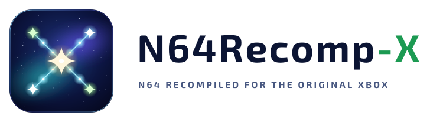

<p align="center">
  <picture>
    <source media="(prefers-color-scheme: dark)" srcset="docs/look/logo/lockup-dark.svg">
    
  </picture>
</p>

# N64Recomp-X

Nintendo 64 games running natively on an original Xbox, by static
recompilation.

Your own ROM goes through [N64Recomp](https://github.com/N64Recomp/N64Recomp),
which turns the game's code into C; that C is compiled for the Xbox's
Pentium III and linked with this project's runtime, which replaces the N64's
operating system, draws the game's display lists on the Xbox's own GPU and
plays its audio through the AC97. Not an emulator. The same platform layer
runs [Melee-X](https://github.com/TechProGabe/Melee-X),
[OpenCrossing-Xbox](https://github.com/TechProGabe/OpenCrossing-Xbox) and
[Wings64-X](https://github.com/TechProGabe/Wings64-X).

**Status: experimental release, [`v1-experimental`](https://github.com/TechProGabe/N64Recomp-X/releases/latest)
(1.0.0-experimental), still in active development.** `n64rx` takes your ROM and
builds an XBE **from the ROM alone**: it finds the game's code, its
segments and its libultra functions itself, with no decompilation and no
per-game file needed.

Every game has a tier ([`docs/compat.md`](docs/compat.md)), and only a
real Xbox moves a game up:

- **Gold**, fully playable with no major issues: Super Mario 64, Pilotwings 64, Super Smash Bros.,
  Diddy Kong Racing.
- **Silver**, playable, with issues that do not stop you: Mario Kart 64,
  GoldenEye 007, Banjo-Kazooie, Ocarina of Time, Castlevania: Legacy of Darkness.
  (GoldenEye's and Banjo-Kazooie's rating comes from builds that used the
  console's learning rounds; built from the ROM alone they run slower for
  now; closing that gap is the next step.)
- **Experimental**, everything else: it may boot, run partly, or not at
  all. Across a whole library, all 246 games build today and 192
  present frames in xemu (sweep s16, with the dry boot), far fewer run well yet; what blocks the rest is tracked in
  [`docs/analyzer.md`](docs/analyzer.md). The plan is
[`docs/PLAN.md`](docs/PLAN.md); what was verified, and how, is
[`docs/handoff.md`](docs/handoff.md).

## Three steps

1. Download the app for your computer from the
   [latest release](https://github.com/TechProGabe/N64Recomp-X/releases/latest)
   (Windows `N64Recomp-X-<version>-win-x64.zip`, macOS on Apple silicon
   `.dmg` or `.zip`, Linux `.AppImage`),
   unzip it to a folder you own and start `N64Recomp-X.exe`: nothing to
   install and nothing more to download, the build tools are inside it.
   What it writes goes into an `N64Recomp-X Data` folder next to the app;
   deleting the app's folder removes everything. The app is not signed
   yet: on Windows choose More info, then Run anyway; on macOS right-click
   the app and choose Open. (To build the app yourself, see
   [`app/README.md`](app/README.md).)
2. Drop your ROM on the window. It shows the game, its tier and its known
   problems. Choose an Xbox folder (XBE) or a disc image (ISO), press
   Build, and say where to save it: about 1 to 3 minutes.
3. Copy the folder to your Xbox (`E:\Games\`) and start `default.xbe`, or
   press Send to Xbox (FTP, login `xbox` / `xbox` by default); or burn the
   ISO. Your ROM is inside `default.xbe` (it is checked by SHA-1 at every
   start), so each game is one file to copy, plus its icon (`default.tbn`).

### From the command line

1. Install Docker Desktop, or run `n64rx doctor --install` for a native
   toolchain (Windows, macOS, Linux; verified on Windows so far). `n64rx doctor` says what is there and
   what is missing.
2. `n64rx info "Your Game (USA).z64"` says what it is and how well it runs;
   `n64rx build "Your Game (USA).z64"` builds it (`--iso FILE` for a disc
   image; or drop the ROM onto `n64rx.cmd` on Windows).
3. Copy the folder it makes (`out/<game>/`) to your Xbox, or
   `n64rx deploy out/<game> --ftp <the Xbox's address>`.

Nothing leaves your machine except what you send to your own Xbox: the ROM
is read where it is, the build is local, and the tool uploads nothing to
anyone else (Send to Xbox / `n64rx deploy` copies the game folder to the
console over your local network by FTP, which is unencrypted).

From a checkout today:

```sh
git clone --recursive https://github.com/TechProGabe/N64Recomp-X && cd N64Recomp-X
./n64rx doctor                                  # n64rx.cmd doctor on Windows
python tools/xbox/make_test_rom.py build-host/test/test.z64
./n64rx build build-host/test/test.z64          # -> out/N64Recomp-X test/
```

## On the console

| | |
|---|---|
| hold L + R (both triggers) while it loads | safe video: this boot runs 480i 4:3, and it is saved |
| hold L + R + START | safe video and the default settings |
| hold BACK while it loads | the settings menu opens before the game starts |
| BACK (a tap) | the port's settings menu, over the paused game (video, widescreen, volume, controllers, Controller Paks per port) |
| BACK + WHITE | a screenshot (test builds, or with screenshots on) |
| L + R + BACK + BLACK | back to the dashboard, anywhere |
| L + R + BACK + WHITE | restart, anywhere |

Every game gets the same port: the "TechProGabe Presents..." loading screen,
output up to 720p (720p so far in xemu; 480i and 480p on a console), widescreen, the BACK menu and the exit combos. Nothing
from any game ships with this project, no built game is ever published, and
nothing derived from a ROM is committed here ([`LICENSE.md`](LICENSE.md)).
